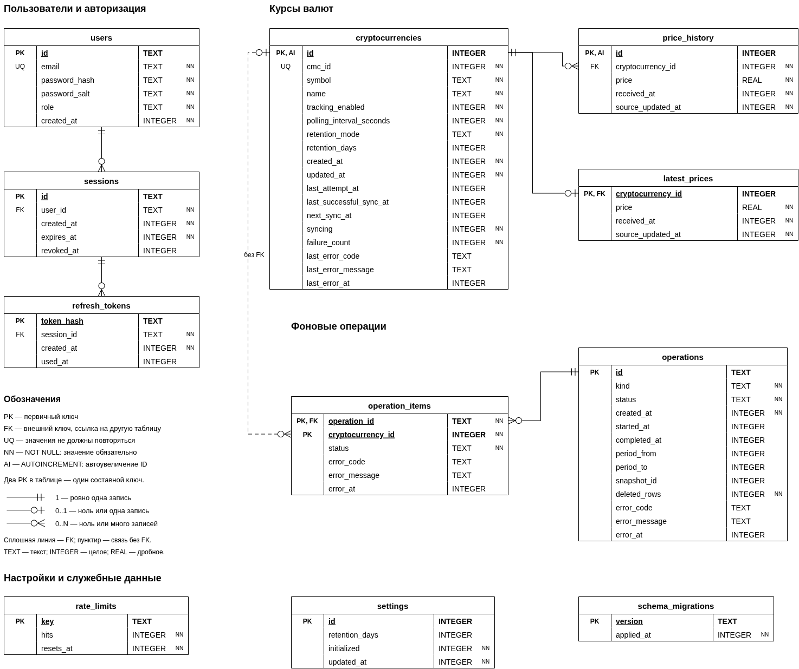

# Crypto Tracker

REST API для отслеживания цен криптовалют через CoinMarketCap. Сервис ведёт общий список валют, периодически получает котировки в USD и сохраняет собственную историю наблюдений в SQLite.

Стек: Node.js, TypeScript, Express 5, SQLite, axios, Jest и Supertest. API описано в [OpenAPI 3.0](openapi.json); Swagger UI доступен после запуска сервера.

## Функциональность

Основная часть задания:

- Управление списком отслеживаемых криптовалют: добавление, просмотр, изменение и удаление.
- Получение котировок CoinMarketCap в USD, сохранение истории в SQLite и выборка цен за период.
- Автоматическое обновление цен, обработка таймаутов и ошибок провайдера, корректная остановка фоновой работы.
- Bearer-авторизация собственного API. Ключ CoinMarketCap хранится только на сервере в переменных окружения.

## Дополнения к заданию

- Регистрация, вход по JWT, обновление токенов и выход. Пользователь с ролью `USER` просматривает данные, а `ADMIN` управляет валютами и настройками. Для серверных интеграций оставлен отдельный API key с доступом на чтение.
- Индивидуальный период опроса каждой валюты и возможность приостановить отслеживание без удаления данных.
- Общий и индивидуальный срок хранения истории, включая хранение без ограничения. Старые записи удаляются автоматически.
- Ручное обновление цен и очистка истории за выбранный период для всех или выбранных валют. Операции выполняются в фоне, их состояние и результаты доступны через API.
- Агрегаты для графиков: цены открытия и закрытия, минимум, максимум, среднее и число наблюдений за интервал.

Фронтенд в проект не входит. Проверить API можно через Swagger UI или curl; описание реализации находится в разделе [«Устройство проекта»](#устройство-проекта), а таблицы и связи показаны на [даталогической схеме](#даталогическая-схема).

## Быстрый старт

Команды выполняются из корня проекта. Выберите [локальный запуск](#локально) или [Docker Compose](#через-docker-compose).

### Локально

Нужен Node.js 24.15 или новее в ветке 24; установка через nvm описана в разделе [«Запуск»](#запуск).

```bash
npm ci --ignore-scripts
npm run setup
```

В созданном `.env` укажите `CMC_API_KEY`. Если нужно проверить сервис без ключа, установите `SYNC_ENABLED=false`: регистрация, вход и чтение данных будут работать, но котировок в новой БД ещё не будет. Подробнее о ключе и начальных данных - в разделе [«Запуск»](#запуск).

```bash
npm run build
npm start
```

### Через Docker Compose

Нужен Docker с плагином Compose. Если `.env` ещё нет, создайте его из примера:

```bash
cp .env.example .env
```

В `.env` задайте `JWT_SECRET` случайной строкой длиной не менее 32 байт и укажите `CMC_API_KEY`. Для проверки без CoinMarketCap установите `SYNC_ENABLED=false`. Если файл уже создан через `npm run setup`, `JWT_SECRET` в нём заполнен.

```bash
docker compose up --build -d
docker compose logs -f api
```

Зависимости устанавливаются и TypeScript собирается внутри образа. Для остановки:

```bash
docker compose down
```

Данные БД сохраняются в volume после остановки. Настройки контейнера и команда создания администратора описаны в разделе [«Docker»](#docker).

### Проверка API и тестов

Откройте [Swagger UI](http://localhost:3000/docs); состояние сервера и БД можно проверить через [health](http://localhost:3000/health). Сначала [зарегистрируйтесь и войдите](#быстрая-проверка), затем вставьте `accessToken` в Authorize без префикса `Bearer`. Для проверки изменения валют и настроек создайте администратора [локально](#администратор) или [в контейнере](#docker) и войдите под ним.

| Что проверить | Команда | Подробности |
| --- | --- | --- |
| Все тесты | `npm test` | [Состав тестов и подготовка данных](#тесты) |
| Покрытие кода | `npm run test:coverage` | [Тесты](#тесты); отчёт сохраняется в `coverage/` |

Тесты запускаются локально после установки Node.js и зависимостей командой `npm ci --ignore-scripts`. Ключ CoinMarketCap и запущенный сервер не нужны. Обе тестовые команды сами собирают проект. Настройки порта, БД, авторизации и опроса описаны в разделе [«Переменные окружения»](#переменные-окружения), список маршрутов - в разделе [«API»](#api).

## Запуск

Требуется Node.js 24.15 или новее в ветке 24. В проекте используется встроенный `node:sqlite`, поэтому отдельный драйвер БД не нужен. Минимальная версия выше указанной в задании Node.js 18: это позволяет работать с SQLite, не добавляя библиотеки за пределами разрешённого стека. В Node.js 24.15 модуль имеет статус release candidate ([документация](https://nodejs.org/download/release/v24.15.0/docs/api/sqlite.html)).

При использовании nvm:

```bash
nvm install 24
nvm use 24
```

Установка и подготовка конфигурации:

```bash
npm ci --ignore-scripts
npm run setup
```

`setup` создаёт `.env` на основе `.env.example` и генерирует случайные `JWT_SECRET` и `SERVICE_API_KEY`. Существующий файл не перезаписывается. Установочные скрипты зависимостей проекту не нужны, поэтому установка выполняется с `--ignore-scripts`.

Для получения цен нужен ключ CoinMarketCap. Он доступен в Developer Dashboard после [регистрации](https://pro.coinmarketcap.com/signup). Ключ записывается в серверный `.env`:

```dotenv
CMC_API_KEY=ключ_из_кабинета
SYNC_ENABLED=true
```

Доступность Quotes Latest, каталога и лимиты запросов зависят от аккаунта CoinMarketCap. Порядок получения ключа приведён в [инструкции провайдера](https://coinmarketcap.com/api/documentation/guides/quick-start).

```bash
npm run build
npm start
```

По умолчанию сервер слушает порт 3000:

- [Swagger UI](http://localhost:3000/docs)
- [Спецификация OpenAPI](http://localhost:3000/openapi.json)
- [Проверка HTTP-сервера и БД](http://localhost:3000/health)

Файл `data/crypto.db` создаётся при первом запуске. Начальный список состоит из BTC, ETH и SOL. История появляется после успешных обращений к CoinMarketCap; исторические котировки за время до запуска не загружаются.

Для запуска без ключа достаточно задать `SYNC_ENABLED=false`. Регистрация, вход, чтение сохранённых данных и очистка работают. Поиск в каталоге, добавление валюты и ручное обновление требуют `CMC_API_KEY`.

Для разработки после первой сборки используются два терминала: `npm run watch` перекомпилирует TypeScript, `npm run dev` перезапускает сервер при изменении сборки.

### Администратор

Регистрация через API всегда создаёт пользователя с ролью `USER`. Администратор создаётся серверной командой. В `.env` нужно временно указать `ADMIN_EMAIL` и `ADMIN_PASSWORD`, затем выполнить:

```bash
npm run admin:create
```

Команда использует ту же БД и правила проверки пароля, что и сервер. Пароль должен содержать от 12 до 128 символов. Если email уже занят, команда завершится ошибкой и не изменит существующий аккаунт. После создания `ADMIN_EMAIL` и `ADMIN_PASSWORD` можно убрать из `.env`.

Администратор входит через обычный `POST /api/v1/auth/sessions`. Роль нельзя выбрать в запросе регистрации или получить через служебный API key.

### Быстрая проверка

Регистрация и вход обычного пользователя:

```bash
curl -X POST http://localhost:3000/api/v1/users \
    -H 'Content-Type: application/json' \
    -d '{"email":"reader@example.com","password":"example-password-123"}'

curl -c cookies.txt -X POST http://localhost:3000/api/v1/auth/sessions \
    -H 'Content-Type: application/json' \
    -d '{"email":"reader@example.com","password":"example-password-123"}'
```

В ответе на вход приходит `accessToken`. Его значение нужно подставить в следующие запросы:

```bash
TOKEN='accessToken_из_ответа'

curl http://localhost:3000/api/v1/cryptocurrencies \
    -H "Authorization: Bearer $TOKEN"

curl http://localhost:3000/api/v1/prices/latest \
    -H "Authorization: Bearer $TOKEN"

curl -b cookies.txt -c cookies.txt -X POST http://localhost:3000/api/v1/auth/tokens
curl -b cookies.txt -c cookies.txt -X DELETE http://localhost:3000/api/v1/auth/sessions/current
```

Обновление и выход в примере используют refresh cookie. Swagger также сохраняет cookie после входа; JWT для остальных запросов вводится в Authorize без префикса `Bearer`.

## API

Базовый путь: `/api/v1`. В таблице «чтение» означает доступ по JWT пользователя любой роли или по служебному `SERVICE_API_KEY`. Административные операции требуют JWT с ролью `ADMIN`. Запрос без авторизации возвращает 401, попытка выполнить административную операцию с правами пользователя или служебным ключом - 403.

| Метод | Путь | Назначение и доступ |
| --- | --- | --- |
| POST | `/users` | Регистрация без авторизации |
| GET | `/users/me` | Свой профиль по JWT |
| POST | `/auth/sessions` | Вход без авторизации |
| POST | `/auth/tokens` | Обновление JWT по refresh cookie |
| DELETE | `/auth/sessions/current` | Выход по JWT или refresh cookie |
| GET | `/cryptocurrency-catalog` | Поиск по `symbol` в CoinMarketCap, ADMIN |
| GET | `/cryptocurrencies` | Список валют, чтение |
| POST | `/cryptocurrencies` | Добавление валюты, ADMIN |
| PATCH | `/cryptocurrencies` | Массовая смена политики хранения, ADMIN |
| GET | `/cryptocurrencies/{cryptocurrencyId}` | Валюта и её настройки, чтение |
| PATCH | `/cryptocurrencies/{cryptocurrencyId}` | Изменение настроек валюты, ADMIN |
| DELETE | `/cryptocurrencies/{cryptocurrencyId}` | Удаление валюты, ADMIN |
| GET | `/prices/latest` | Последние котировки, чтение |
| GET | `/cryptocurrencies/{cryptocurrencyId}/prices/latest` | Последняя котировка валюты, чтение |
| GET | `/cryptocurrencies/{cryptocurrencyId}/price-history` | История наблюдений, чтение |
| GET | `/cryptocurrencies/{cryptocurrencyId}/price-aggregates` | Агрегаты для графиков, чтение |
| GET | `/settings` | Общие настройки, ADMIN |
| PATCH | `/settings` | Изменение общей политики хранения, ADMIN |
| POST | `/price-synchronizations` | Ручное обновление цен, ADMIN |
| GET | `/price-synchronizations/{synchronizationId}` | Результат обновления, ADMIN |
| POST | `/price-history-deletions` | Очистка истории за период, ADMIN |
| GET | `/price-history-deletions/{deletionId}` | Результат очистки, ADMIN |

Полные схемы, параметры, примеры тел и коды ответов находятся в `openapi.json`. Успешное создание пользователя, сессии или валюты возвращает 201; принятие фонового задания - 202 с заголовком `Location`; удаление валюты и выход - 204.

### Валюты и история

`cmcId` идентифицирует актив в CoinMarketCap. `cryptocurrencyId` в маршрутах - ID записи в нашей БД. Символы могут повторяться, поэтому для добавления используется `cmcId`: сначала `GET /cryptocurrency-catalog?symbol=BTC`, затем `POST /cryptocurrencies` с выбранным ID. Название и символ сервер получает у провайдера. Повторное добавление возвращает 409.

`PATCH /cryptocurrencies/{cryptocurrencyId}` принимает период опроса от 60 до 86400 секунд, `trackingEnabled` и политику хранения. Пауза останавливает автоматический опрос и сохраняет данные. Возобновление делает валюту доступной для обновления на ближайшем цикле. `DELETE` удаляет валюту вместе с котировкой и историей; активное ручное обновление этой валюты блокирует удаление с ответом 409.

Списки валют и последних цен принимают `limit` и `cursor`. Для валют доступен фильтр `trackingEnabled=true` или `false`, для котировок - `cryptocurrencyIds=1,2`. Следующая страница указана в `page.nextCursor`; фильтры при переходе менять нельзя.

История требует `from` и `to` в RFC 3339 с часовым поясом. Например:

```bash
curl -G http://localhost:3000/api/v1/cryptocurrencies/1/price-history \
    -H "Authorization: Bearer $TOKEN" \
    --data-urlencode 'from=2026-10-10T00:00:00Z' \
    --data-urlencode 'to=2026-10-11T00:00:00Z' \
    --data-urlencode 'limit=100'
```

ID и даты в примере нужно заменить на валюту и период, для которых накоплены данные. Пустой результат возвращается как `data: []`. Период `[from, to)` относится к времени получения котировки сервером и ограничен 366 сутками. Курсор подписан HMAC и фиксирует верхний ID истории: добавленные позже наблюдения не попадают в следующие страницы.

Для агрегатов используется тот же период и параметр `intervalSeconds`: 60, 300, 900, 3600 или 86400. В ответе содержатся `open`, `high`, `low`, `close`, `average` и `count`. Интервалы выровнены по UTC; пустые пропускаются. Допускается до 2000 потенциальных интервалов. Это агрегаты сохранённых наблюдений, а не данные о каждой сделке на бирже.

Последняя котировка имеет статус `pending`, если данных ещё нет. Статус `fresh` означает, что и время получения, и время обновления у провайдера не старше двух периодов опроса. Иначе возвращается `stale`. Ошибка синхронизации не удаляет последнюю успешную цену.

### Хранение и ручные задания

Политика хранения задаётся одним из объектов:

| Политика | Значение |
| --- | --- |
| `{"mode":"days","days":30}` | Хранить историю 30 суток; допустимы 1-3650 суток |
| `{"mode":"forever"}` | Отключить автоматическое удаление истории |
| `{"mode":"inherit"}` | Использовать общую политику; доступно только у валюты |

Общая настройка меняется через `PATCH /settings` в поле `defaultRetentionPolicy`. Она влияет на валюты с `inherit`; индивидуальные настройки сохраняются. Уменьшение срока приводит к удалению старых записей при следующей очистке.

Для массового изменения используется `PATCH /cryptocurrencies`:

```json
{
    "selection": { "scope": "all" },
    "changes": { "retentionPolicy": { "mode": "forever" } }
}
```

`selection` можно заменить на `{"scope":"selected","cryptocurrencyIds":[1,2]}`. Выборка `all` включает приостановленные валюты. Неизвестный ID отклоняет всю операцию, без частичного изменения настроек.

Ручное обновление `POST /price-synchronizations` принимает тело `{"selection":{"scope":"all"}}` или выборку по ID. Ответ содержит идентификатор задания и `Location` для проверки результата. Состояния: `queued`, `running`, `succeeded`, `partially_succeeded`, `failed`. Результаты по валютам находятся в `items`. Задание может обновить приостановленную валюту один раз, не возобновляя её автоматическое отслеживание.

Очистка `POST /price-history-deletions` дополнительно принимает `from` и `to`:

```json
{
    "selection": { "scope": "selected", "cryptocurrencyIds": [1, 2] },
    "from": "2026-09-01T00:00:00Z",
    "to": "2026-10-01T00:00:00Z"
}
```

Даты задают `[from, to)`; конец не должен быть в будущем. Ограничения в 366 суток у удаления нет. Результат содержит `deletedRows`; состояния `partially_succeeded` у очистки нет. Чтение существующего задания возвращает 200, в том числе если само задание завершилось с ошибкой.

Список валют фиксируется при принятии задания. Очистка также фиксирует максимальный ID истории, поэтому новые наблюдения не удаляются. Пересекающиеся активные обновления одной валюты возвращают 409. Для очисток конфликт проверяется ещё и по пересечению периодов. Последняя котировка хранится отдельно и после очистки истории остаётся доступной.

## Устройство проекта

Код разделён по предметным модулям. Внутри модуля `routes.ts` задаёт маршруты и middleware, контроллер разбирает HTTP-запрос и формирует ответ, сервис выполняет сценарий, репозиторий работает с SQL. Зависимости передаются через конструкторы и собираются в `runtime.ts`.

| Каталог или файл | Назначение |
| --- | --- |
| `src/auth/` | Пользователи, сессии, JWT, пароли и проверка доступа |
| `src/currencies/` | Каталог, отслеживаемые валюты и их настройки |
| `src/prices/` | Сохранение котировок, история, агрегаты, курсоры и очистка |
| `src/settings/` | Общая политика хранения |
| `src/operations/` | Очередь ручных заданий и результаты выполнения |
| `src/jobs/` | Фоновый цикл и синхронизация котировок |
| `src/integrations/coinmarketcap/` | HTTP-клиент, проверка ответов и ошибки провайдера |
| `src/http/` | CORS, валидация HTTP, единый ответ об ошибке, health и Swagger |
| `src/config/` | Чтение и проверка переменных окружения |
| `src/database.ts`, `migrations/001_initial.sql` | Подключение SQLite, транзакции и схема |
| `src/runtime.ts`, `src/app.ts`, `src/server.ts` | Сборка зависимостей, приложение Express и запуск процесса |
| `src/commands/create-admin.ts` | Создание администратора из терминала |

Общие для модуля типы находятся в `types.ts`, внутренние типы остаются рядом с кодом. В проекте используются отступы в 4 пробела; настройки редактора и форматтера находятся в `.editorconfig` и `.prettierrc.json`.

### База данных

Схема создаётся одной начальной миграцией. Факт её выполнения записывается в `schema_migrations`, поэтому перезапуск не пересоздаёт таблицы. При изменении начальной схемы во время разработки для проверки с нуля можно указать новый файл в `DB_PATH`.

| Таблицы | Что хранится |
| --- | --- |
| `users`, `sessions`, `refresh_tokens` | Пользователи, активные и отозванные сессии, хеши refresh-токенов |
| `rate_limits` | Счётчики попыток регистрации, входа и обновления токена |
| `cryptocurrencies` | CMC ID, название, настройки, расписание и результат последней синхронизации |
| `price_history` | Цена, время получения сервером и время обновления у провайдера |
| `latest_prices` | Последняя успешная котировка каждой валюты |
| `settings` | Общая политика хранения и признак начального заполнения |
| `operations`, `operation_items` | Состояние ручных заданий и результаты по валютам |

ORM не используется. Запросы написаны на SQL, пользовательские значения передаются через параметры. Включены внешние ключи и WAL. Индекс истории по валюте и времени используется для выборок за период; отдельные индексы обслуживают расписание синхронизации и очередь.

SQL выполняется синхронно через `DatabaseSync`. Внутри транзакций нет сетевых запросов или `await`. Запись истории, последней котировки и состояния валюты атомарна. При ручном обновлении результат по валюте сохраняется в той же транзакции. Вложенные вызовы используют savepoint, чтобы ошибка внешней операции откатывала и вложенную запись.

#### Даталогическая схема



[Исходник схемы для редактирования в draw.io](schemas/crypto-tracker-sqlite-schema.drawio).

### Авторизация

Пароли хешируются асинхронным `scrypt` с отдельной солью. JWT подписывается HS256 через `node:crypto`; дополнительных библиотек авторизации нет из-за ограничения стека в задании. Проверяются алгоритм, подпись, срок, issuer и audience. При каждом запросе сервер также читает сессию и текущую роль пользователя из БД. Поэтому выход отзывает уже выданные JWT этой сессии сразу.

Access token действует 15 минут, сессия - 7 суток по умолчанию. Refresh token передаётся в `HttpOnly; SameSite=Strict` cookie и хранится в БД в виде хеша. При обновлении токен заменяется; повторное использование старого отзывает сессию. Регистрация, вход и refresh ограничены по IP, счётчики сохраняются в SQLite.

В проекте три независимых секрета: `CMC_API_KEY` для запросов к провайдеру, `JWT_SECRET` для подписи JWT и необязательный `SERVICE_API_KEY` для чтения собственного API серверными интеграциями. Служебный ключ передаётся как `Authorization: Bearer ctk_…`. Клиентское приложение использует JWT; серверные ключи ему не выдаются.

При подключении браузерного клиента нужно задать `FRONTEND_ORIGIN`. Для входа, refresh и выхода используется `credentials: 'include'`. Access token можно хранить в памяти клиента, а после перезагрузки страницы получать новый через `POST /auth/tokens`. Одновременно следует отправлять только один refresh-запрос. Cookie рассчитана на frontend и API в пределах одного site; для локальной разработки следует везде использовать одинаковый hostname, например `localhost`.

### Фоновая работа и ошибки

Работает один цикл на основе `setTimeout`: следующий запуск планируется после завершения предыдущего. Цикл очищает устаревшие данные по расписанию, выполняет очередное ручное задание и выбирает валюты, у которых наступил `next_sync_at`. Автоматические и ручные обновления цен выполняются последовательно.

Клиент CoinMarketCap использует `/v3/cryptocurrency/quotes/latest` для цен и `/v1/cryptocurrency/map` для каталога. Ключ передаётся только сервером в заголовке `X-CMC_PRO_API_KEY`. Готовые к обновлению валюты запрашиваются одним пакетом по CMC ID, с `convert=USD`. Полученный ответ проверяется до записи в БД; ошибка отдельной валюты не мешает сохранить остальные корректные котировки.

У запросов есть таймаут и ограниченное число повторов при сетевых ошибках, таймаутах и 5xx. После неудачного цикла задержка опроса валюты увеличивается, собственный backoff ограничен часом. При 429 учитывается `Retry-After`, без немедленного повтора запроса. Ошибка ключа и некорректный ответ тоже сохраняются в состоянии валюты. Последняя успешная цена продолжает возвращаться из БД.

Автоматическая очистка учитывает общую и индивидуальную политику, включая приостановленные валюты. История удаляется порциями, между которыми управление возвращается event loop. Ручная очистка устроена так же; если её прервать, уже удалённые порции не восстанавливаются.

Очередь и результаты находятся в SQLite. После перезапуска задания `queued` продолжают ждать выполнения. Прерванные `running` получают ошибку `OPERATION_INTERRUPTED`; результаты уже обновлённых валют сохраняются, итоговый статус синхронизации вычисляется по ним.

При SIGINT/SIGTERM сервер прекращает принимать новые запросы, отменяет таймер и обращения к CoinMarketCap, дожидается текущей работы и закрывает БД. Для остановки предусмотрен общий таймаут.

Все входные параметры проверяются; неизвестные поля и query-параметры отклоняются. Ошибки возвращаются в `application/problem+json` с полями `status`, `code`, `detail`, `requestId` и, для ошибок валидации, `invalidParams`. Ответы содержат `X-Request-Id`; секреты и исходные ответы axios клиенту не передаются.

## Переменные окружения

Полный набор находится в [`.env.example`](.env.example). Значения проверяются при запуске; некорректный параметр останавливает приложение. Переменные процесса имеют приоритет над `.env`. После изменения конфигурации нужен перезапуск.

### Сервер

| Переменная | По умолчанию | Назначение |
| --- | --- | --- |
| `NODE_ENV` | `development` | Также доступны `test` и `production` |
| `HOST`, `PORT` | `0.0.0.0`, `3000` | Адрес и порт прослушивания |
| `DB_PATH` | `./data/crypto.db` | Файл SQLite; режим `:memory:` не допускается |
| `SQLITE_BUSY_TIMEOUT_MS` | `5000` | Ожидание блокировки БД |
| `API_ORIGIN` | `http://localhost:3000` | Публичный origin API, в том числе для Swagger |
| `FRONTEND_ORIGIN` | Значение `API_ORIGIN` | Разрешённый origin браузерного клиента |
| `TRUST_PROXY_HOPS` | `0` | Число доверенных reverse proxy |
| `BODY_LIMIT_BYTES` | `16384` | Максимальный размер JSON |
| `LOG_LEVEL` | `info` | `info`, `error` или `silent`; сообщения в JSON |
| `SHUTDOWN_TIMEOUT_MS` | `15000` | Предельное время остановки процесса |

Если `API_ORIGIN` не задан, его значение вычисляется по `PORT`; в `.env.example` указано `http://localhost:3000`. Origins задаются без пути и завершающего `/`. В `production` обязательны HTTPS в обоих origins и `COOKIE_SECURE=true`.

### Авторизация

| Переменная | По умолчанию | Назначение |
| --- | --- | --- |
| `JWT_SECRET` | Генерируется `setup` | Секрет подписи, не менее 32 байт |
| `JWT_ISSUER`, `JWT_AUDIENCE` | `crypto-tracker`, `crypto-tracker-api` | Проверяемые claims JWT |
| `ACCESS_TOKEN_TTL_SECONDS` | `900` | Время жизни JWT |
| `REFRESH_TOKEN_TTL_SECONDS` | `604800` | Абсолютный срок сессии |
| `COOKIE_SECURE` | `false` локально | Передача cookie только по HTTPS при `true` |
| `SERVICE_API_KEY` | Генерируется `setup` | Служебный ключ; пустое значение отключает этот доступ |
| `AUTH_RATE_LIMIT_MAX` | `30` | Число попыток на IP отдельно для регистрации, входа и refresh |
| `AUTH_RATE_LIMIT_WINDOW_SECONDS` | `900` | Окно ограничения попыток |
| `ADMIN_EMAIL`, `ADMIN_PASSWORD` | Не заданы | Только для `npm run admin:create` |

### CoinMarketCap и история

| Переменная | По умолчанию | Назначение |
| --- | --- | --- |
| `CMC_API_KEY` | Не задан | Ключ провайдера; обязателен при `SYNC_ENABLED=true` |
| `CMC_TIMEOUT_MS` | `10000` | Таймаут одной попытки запроса |
| `CMC_MAX_RETRIES` | `2` | Число дополнительных попыток |
| `CMC_RETRY_DELAY_MS` | `500` | Начальная задержка повтора, затем удваивается |
| `CMC_RATE_LIMIT_COOLDOWN_SECONDS` | `60` | Задержка при 429 без корректного `Retry-After` |
| `SYNC_ENABLED` | `true` | Автоматическое обновление; ручные задания и очистка работают и при `false` |
| `POLL_INTERVAL_SECONDS` | `300` | Период для начального списка и новых валют, 60-86400 секунд |
| `SYNC_TICK_MS` | `5000` | Пауза между проверками расписания |
| `SYNC_ERROR_BACKOFF_SECONDS` | `60` | Начальная задержка после неудачного обновления |
| `TRACKED_CURRENCIES` | BTC, ETH, SOL | JSON-массив для первого запуска; `[]` оставляет список пустым |
| `DEFAULT_RETENTION_DAYS` | `30` | Начальная общая политика: 1-3650 суток или `forever` |
| `CLEANUP_INTERVAL_SECONDS` | `3600` | Период очистки истории, истёкших сессий и счётчиков запросов |
| `CLEANUP_BATCH_SIZE` | `1000` | Число записей истории в одной порции удаления |

Пример начального списка:

```dotenv
TRACKED_CURRENCIES='[{"cmcId":1,"symbol":"BTC","name":"Bitcoin"},{"cmcId":1027,"symbol":"ETH","name":"Ethereum"}]'
```

`TRACKED_CURRENCIES` и `DEFAULT_RETENTION_DAYS` применяются при начальном заполнении БД. Затем список, периоды опроса и политики хранения меняются через API. Перезапуск не сбрасывает эти изменения и не восстанавливает удалённые валюты. Ключи не должны попадать в переменные клиентской сборки вроде `VITE_*`.

## Тесты

```bash
npm test
npm run test:coverage
```

Обе команды сначала собирают TypeScript. Тесты написаны на CommonJS и проверяют скомпилированные модули из `dist`; дополнительные трансформеры TypeScript для Jest не используются.

- `tests/unit/` проверяет конфигурацию и JWT.
- `tests/integration/` проверяет HTTP API через Supertest, клиент CoinMarketCap, команду создания администратора и жизненный цикл сервера.
- `tests/jobs/` проверяет расписание, ошибки провайдера, очередь, очистку, конкурентные запросы и остановку фоновой работы.
- `tests/support/` содержит общую подготовку временной БД, пользователей, котировок и запуска процесса.

Каждый сценарий получает отдельный файл SQLite во временном каталоге. В тестах API провайдер подменяется, а тесты HTTP-клиента проверяют axios отдельно. Таймаут проверяется также на локальном HTTP-сервере. Запросов к реальному CoinMarketCap нет, ключ для запуска тестов не требуется.

Для каждой операции API есть положительный и отрицательный сценарий. Дополнительно проверяются права `USER` и `ADMIN`, служебный ключ, ротация refresh-токенов, атомарность записи цен, сохранение настроек и очереди после перезапуска, SIGINT и SIGTERM.

## Docker

После подготовки `.env`:

```bash
docker compose up --build -d
docker compose logs -f api
```

Контейнер работает от пользователя `node`, данные находятся в volume `crypto-data`, порт опубликован на `127.0.0.1`. Для локального запуска через Compose подходит `NODE_ENV=development` из `.env.example`. Серверный `.env` не копируется в образ.

Создать администратора именно в контейнерной БД можно после заполнения `ADMIN_EMAIL` и `ADMIN_PASSWORD` в `.env`:

```bash
docker compose run --rm api npm run admin:create
```

Затем эти две переменные можно убрать. `docker compose down` останавливает сервис и сохраняет volume.

## Ограничения

Сервис рассчитан на один процесс и до 100 отслеживаемых валют. Планирование выполняется внутри процесса; запуск нескольких экземпляров с одной БД не поддерживается. Синхронные запросы SQLite и размеры выборок рассчитаны на объём тестового задания.

Все цены выражены в USD. Для них используются JavaScript `number` и SQLite `REAL`: это подходит для истории котировок и графиков, но не для точных денежных расчётов. Частота появления наблюдений зависит от времени ответа и квот CoinMarketCap; заданный период опроса не гарантирует новую цену у провайдера на каждом цикле.

В репозитории находится backend. Восстановление пароля, подтверждение email и управление пользователями через административный API не реализованы. Секреты, БД, зависимости, сборка, отчёты покрытия и cookie-файлы исключены через `.gitignore`.
